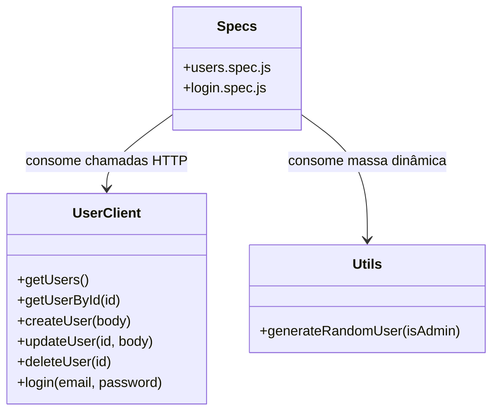
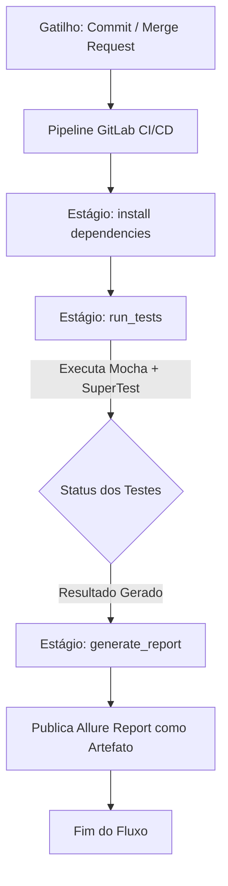

# Desafio de Automação de Testes de API - Carrefour Banco

Este repositório contém a automação de testes de API REST para gerenciamento de usuários baseada nos endpoints públicos da API **ServeRest** (`https://serverest.dev`), atendendo a todos os requisitos do desafio.

---

## 🛠️ Tecnologias e Ferramentas Utilizadas

- **Linguagem:** JavaScript (Node.js)
- **Framework de Testes:** [Mocha v10](https://mochajs.org)
- **Biblioteca de Asserções:** [Chai v5](https://www.chaijs.com) (BDD expect style)
- **Cliente HTTP para Testes:** [SuperTest v7](https://github.com/ladjs/supertest)
- **Relatórios de Execução:** Allure Report
- **Padrão de Organização:** Client/Utility Architecture (desacoplando chamadas HTTP dos testes)
- **Integração Contínua:** GitLab CI/CD

---

## 📋 Mapeamento dos Cenários de Teste

Implementamos **12 cenários de teste** cobrindo 100% dos caminhos felizes e de erro (CRUD completo e Autenticação JWT):

| Cenário | Método | Endpoint Original | Descrição do Cenário | Arquivo Spec |
| :---: | :---: | :--- | :--- | :--- |
| **01** | `POST` | `/usuarios` | Cadastro de usuário com sucesso (Status 201). | [users.spec.js](file:///c:/Projetos/Java_test/Java_teste2/test/specs/users.spec.js) |
| **02** | `POST` | `/usuarios` | Falha de cadastro com e-mail duplicado (Status 400). | [users.spec.js](file:///c:/Projetos/Java_test/Java_teste2/test/specs/users.spec.js) |
| **03** | `POST` | `/usuarios` | Validação de campos obrigatórios ausentes no JSON (Status 400). | [users.spec.js](file:///c:/Projetos/Java_test/Java_teste2/test/specs/users.spec.js) |
| **04** | `GET` | `/usuarios` | Listagem completa de todos os usuários (Status 200). | [users.spec.js](file:///c:/Projetos/Java_test/Java_teste2/test/specs/users.spec.js) |
| **05** | `GET` | `/usuarios/{id}`| Consulta de detalhes de usuário existente por ID (Status 200). | [users.spec.js](file:///c:/Projetos/Java_test/Java_teste2/test/specs/users.spec.js) |
| **06** | `GET` | `/usuarios/{id}`| Falha de consulta com ID inexistente (Status 400). | [users.spec.js](file:///c:/Projetos/Java_test/Java_teste2/test/specs/users.spec.js) |
| **07** | `PUT` | `/usuarios/{id}`| Atualização com sucesso dos dados de usuário existente (Status 200).| [users.spec.js](file:///c:/Projetos/Java_test/Java_teste2/test/specs/users.spec.js) |
| **08** | `PUT` | `/usuarios/{id}`| Criação automática de usuário caso o ID no PUT não exista (Status 201).| [users.spec.js](file:///c:/Projetos/Java_test/Java_teste2/test/specs/users.spec.js) |
| **09** | `DELETE`| `/usuarios/{id}`| Exclusão com sucesso de usuário existente por ID (Status 200).| [users.spec.js](file:///c:/Projetos/Java_test/Java_teste2/test/specs/users.spec.js) |
| **10** | `DELETE`| `/usuarios/{id}`| Falha ou sem efeito ao tentar excluir ID já removido (Status 200).| [users.spec.js](file:///c:/Projetos/Java_test/Java_teste2/test/specs/users.spec.js) |
| **11** | `POST` | `/login` | Autenticação JWT com sucesso, validando recebimento de Token (Status 200).| [login.spec.js](file:///c:/Projetos/Java_test/Java_teste2/test/specs/login.spec.js) |
| **12** | `POST` | `/login` | Falha de autenticação com senha incorreta (Status 401). | [login.spec.js](file:///c:/Projetos/Java_test/Java_teste2/test/specs/login.spec.js) |

---

## 🏗️ Arquitetura do Projeto

Para manter os testes organizados e desacoplados, implementamos a seguinte estrutura de classes e dependências:



---

## 🚀 Fluxo de Execução e CI/CD



---

## 📁 Estrutura de Diretórios

```text
Java_teste2/
├── test/
│   ├── clients/
│   │   └── user.client.js   # Cliente HTTP encapsulando as requisições com SuperTest
│   ├── specs/
│   │   ├── login.spec.js    # Testes de autenticação e JWT (Cenários 11 e 12)
│   │   └── users.spec.js    # Testes do CRUD e listagem de usuários (Cenários 1 a 10)
│   └── utils/
│       └── utils.js         # Auxiliar com gerador dinâmico de massa de dados
├── .gitignore               # Exclusões para controle de versão
├── .gitlab-ci.yml           # Pipeline de CI/CD para execução automática
├── package.json             # Dependências e scripts do projeto NPM
└── README.md                # Documentação técnica do projeto
```

---

## 💻 Setup Local e Execução

### 1. Pré-requisitos
- **Node.js** v18 ou superior instalado.

### 2. Instalação
No diretório `Java_teste2`, instale as dependências executando:
```bash
npm install
```

### 3. Execução dos Testes de API
Rode o comando abaixo para disparar todos os testes automatizados integrados com a API ServeRest real:
```bash
npm test
```

### 4. Geração de Evidências (Allure Report)
Os relatórios Allure salvam evidências estruturadas de logs e informações de execução:
- **Limpar resultados anteriores:** `npm run report:clear`
- **Gerar relatório HTML:** `npm run report:generate`
- **Abrir no navegador:** `npm run report:open`
