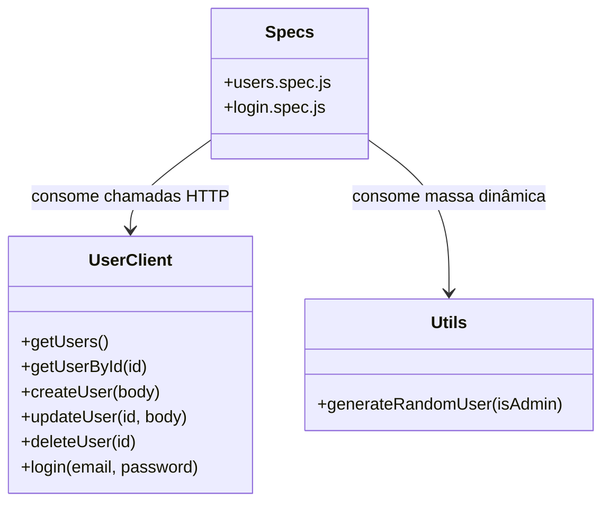
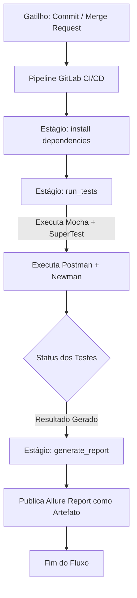

# Desafio de Automação de Testes de API - Carrefour Banco

Este repositório contém a automação de testes de API REST para gerenciamento de usuários baseada nos endpoints públicos da API **ServeRest** (`https://serverest.dev`), atendendo a todos os requisitos do desafio.

---

## 🛠️ Tecnologias e Ferramentas Utilizadas

- **Linguagem:** JavaScript (Node.js)
- **Framework de Testes:** [Mocha v10](https://mochajs.org)
- **Biblioteca de Asserções:** [Chai v5](https://www.chaijs.com) (BDD expect style)
- **Cliente HTTP para Testes:** [SuperTest v7](https://github.com/ladjs/supertest)
- **Relatórios de Execução:** Allure Report
- **Padrão de Organização:** Client/Utility Architecture (desacoplando chamadas HTTP dos testes)
- **Integração Contínua:** GitLab CI/CD

---

## 📋 Mapeamento dos Cenários de Teste

Implementamos **12 cenários de teste** cobrindo 100% dos caminhos felizes e de erro (CRUD completo e Autenticação JWT):

| Cenário | Método | Endpoint Original | Descrição do Cenário | Arquivo Spec |
| :---: | :---: | :--- | :--- | :--- |
| **01** | `POST` | `/usuarios` | Cadastro de usuário com sucesso (Status 201). | [users.spec.js](file:///c:/Projetos/Java_test/Java_teste2/test/specs/users.spec.js) |
| **02** | `POST` | `/usuarios` | Falha de cadastro com e-mail duplicado (Status 400). | [users.spec.js](file:///c:/Projetos/Java_test/Java_teste2/test/specs/users.spec.js) |
| **03** | `POST` | `/usuarios` | Validação de campos obrigatórios ausentes no JSON (Status 400). | [users.spec.js](file:///c:/Projetos/Java_test/Java_teste2/test/specs/users.spec.js) |
| **04** | `GET` | `/usuarios` | Listagem completa de todos os usuários (Status 200). | [users.spec.js](file:///c:/Projetos/Java_test/Java_teste2/test/specs/users.spec.js) |
| **05** | `GET` | `/usuarios/{id}`| Consulta de detalhes de usuário existente por ID (Status 200). | [users.spec.js](file:///c:/Projetos/Java_test/Java_teste2/test/specs/users.spec.js) |
| **06** | `GET` | `/usuarios/{id}`| Falha de consulta com ID inexistente (Status 400). | [users.spec.js](file:///c:/Projetos/Java_test/Java_teste2/test/specs/users.spec.js) |
| **07** | `PUT` | `/usuarios/{id}`| Atualização com sucesso dos dados de usuário existente (Status 200).| [users.spec.js](file:///c:/Projetos/Java_test/Java_teste2/test/specs/users.spec.js) |
| **08** | `PUT` | `/usuarios/{id}`| Criação automática de usuário caso o ID no PUT não exista (Status 201).| [users.spec.js](file:///c:/Projetos/Java_test/Java_teste2/test/specs/users.spec.js) |
| **09** | `DELETE`| `/usuarios/{id}`| Exclusão com sucesso de usuário existente por ID (Status 200).| [users.spec.js](file:///c:/Projetos/Java_test/Java_teste2/test/specs/users.spec.js) |
| **10** | `DELETE`| `/usuarios/{id}`| Falha ou sem efeito ao tentar excluir ID já removido (Status 200).| [users.spec.js](file:///c:/Projetos/Java_test/Java_teste2/test/specs/users.spec.js) |
| **11** | `POST` | `/login` | Autenticação JWT com sucesso, validando recebimento de Token (Status 200).| [login.spec.js](file:///c:/Projetos/Java_test/Java_teste2/test/specs/login.spec.js) |
| **12** | `POST` | `/login` | Falha de autenticação com senha incorreta (Status 401). | [login.spec.js](file:///c:/Projetos/Java_test/Java_teste2/test/specs/login.spec.js) |

---

## 🏗️ Arquitetura do Projeto

Para manter os testes organizados e desacoplados, implementamos a seguinte estrutura de classes e dependências:



---

## 🚀 Fluxo de Execução e CI/CD



---

## 📁 Estrutura de Diretórios

```text
Java_teste2/
├── postman/
│   ├── ServeRest_API_Tests.postman_collection.json     # Coleção do Postman com os 12 cenários
│   └── ServeRest_Environment.postman_environment.json # Ambiente de execução com variáveis (baseUrl)
├── test/
│   ├── clients/
│   │   └── user.client.js   # Cliente HTTP encapsulando as requisições com SuperTest
│   ├── specs/
│   │   ├── login.spec.js    # Testes de autenticação e JWT (Cenários 11 e 12)
│   │   └── users.spec.js    # Testes do CRUD e listagem de usuários (Cenários 1 a 10)
│   └── utils/
│       └── utils.js         # Auxiliar com gerador dinâmico de massa de dados
├── .gitignore               # Exclusões para controle de versão
├── .gitlab-ci.yml           # Pipeline de CI/CD para execução automática
├── package.json             # Dependências e scripts do projeto NPM
└── README.md                # Documentação técnica do projeto
```

---

## 💻 Setup Local e Execução

### 1. Pré-requisitos
- **Node.js** v18 ou superior instalado.

### 2. Instalação
No diretório `Java_teste2`, instale as dependências executando:
```bash
npm install
```

### 3. Execução dos Testes de API
Rode o comando abaixo para disparar todos os testes automatizados integrados com a API ServeRest real:
```bash
npm test
```

### 4. Geração de Evidências (Allure Report)
Os relatórios Allure salvam evidências estruturadas de logs e informações de execução:
- **Limpar resultados anteriores:** `npm run report:clear`
- **Gerar relatório HTML:** `npm run report:generate`
- **Abrir no navegador:** `npm run report:open`

---

## 📮 Execução via Postman / Newman

Para dar flexibilidade total na avaliação do desafio, também disponibilizamos a suite de testes pronta para rodar no **Postman** e via linha de comando com o **Newman**.

### 1. Rodar no Terminal com Newman CLI
Você pode rodar toda a suite do Postman diretamente na linha de comando do terminal executando:
```bash
npm run test:postman
```
*Esse teste é executado automaticamente no pipeline do GitLab CI/CD como parte da validação de qualidade.*

**Relatórios gerados pelo Newman:**
Após a execução do comando acima, os seguintes relatórios serão gerados na pasta `postman/`:
* `newman-report.html`: Relatório HTML interativo detalhado (gerado pelo `htmlextra`).
* `newman-report.xml`: Relatório no formato JUnit XML, que é consumido pelo GitLab CI para exibir os resultados diretamente na aba **Tests** da pipeline.

### 2. Importar e Executar no Postman (Interface Gráfica)
1. Abra o aplicativo desktop do **Postman**.
2. Clique no botão **Import** (canto superior esquerdo).
3. Selecione os seguintes arquivos localizados na pasta `postman/`:
   - [ServeRest_API_Tests.postman_collection.json](file:///c:/Projetos/Java_test/Java_teste2/postman/ServeRest_API_Tests.postman_collection.json) (Coleção contendo os 12 cenários de teste mapeados)
   - [ServeRest_Environment.postman_environment.json](file:///c:/Projetos/Java_test/Java_teste2/postman/ServeRest_Environment.postman_environment.json) (Arquivo de ambiente com as variáveis configuradas, como `baseUrl` apontando para `https://serverest.dev`)
4. Selecione o ambiente **ServeRest Environment** no seletor de ambientes do Postman (canto superior direito).
5. Abra a coleção importada **ServeRest API Challenge**, clique nos três pontos `...` ao lado dela, selecione **Run collection** e clique no botão azul **Run ServeRest API Challenge** para executar todos os testes sequencialmente.

---

## 🏛️ Padrão de Arquitetura: Client/Utility Architecture

O projeto implementa um padrão **desacoplado e reutilizável** para testes de API:

### **Camada 1: Cliente HTTP (UserClient)**
O arquivo `test/clients/user.client.js` encapsula todas as chamadas HTTP com SuperTest:

```javascript
static async createUser(userData) {
    return supertest(baseUrl)
        .post('/usuarios')
        .send(userData);
}

static async login(email, password) {
    return supertest(baseUrl)
        .post('/login')
        .send({ email, password });
}
```

**Benefícios:**
- ✅ Desacoplamento entre testes e chamadas HTTP
- ✅ Reutilização de métodos em múltiplos testes
- ✅ Fácil manutenção de endpoints (mudança em um único lugar)

### **Camada 2: Utilitários (Utils)**
O arquivo `test/utils/utils.js` fornece geradores de dados dinâmicos:

```javascript
static generateRandomUser(isAdmin = false) {
    return {
        nome: `Usuário Teste ${Date.now()}`,
        email: `user${Date.now()}@teste.com`,
        password: 'SecurePass123!',
        administrador: isAdmin ? 'true' : 'false'
    };
}
```

**Benefícios:**
- ✅ Evita conflito de dados entre testes (cada chamada gera email único)
- ✅ Dados replicáveis e consistentes
- ✅ Isolamento automático entre execuções

### **Camada 3: Testes (Specs)**
Os arquivos `test/specs/*.spec.js` consome as camadas anteriores:

```javascript
it('Cenário 1: Cadastro com sucesso', async () => {
    const testUser = generateRandomUser();
    const response = await UserClient.createUser(testUser);
    
    expect(response.status).to.equal(201);
});
```

**Resultado:**
- ✅ Testes limpos e legíveis
- ✅ Foco no comportamento, não em detalhes técnicos
- ✅ Fácil adicionar novos cenários

---

## 📝 Notas Técnicas

### Isolamento de Testes
Cada teste é **independente** através de:
- **Massa de dados dinâmica:** Cada usuário criado recebe email único (timestamp + random)
- **Limpeza automática:** Testes `DELETE` removem dados criados nos testes anteriores
- **Timeout de 15 segundos:** Configurado em `package.json` para permitir latência da API remota

### Configuração de Timeout
No `package.json`, o timeout é definido como 15 segundos:
```json
{
  "scripts": {
    "test": "mocha test/specs/**/*.spec.js --reporter allure-mocha --timeout 15000"
  }
}
```

**Motivo:** A API ServeRest é pública e pode ter latência variável. O timeout de 15s oferece margem suficiente sem deixar testes pendurados indefinidamente.

### Variáveis de Ambiente
A URL da API é definida como variável no `test/clients/user.client.js`:
```javascript
const baseUrl = 'https://serverest.dev';
```

Para alterá-la em um ambiente customizado, basta modificar esta constante e executar os testes.

